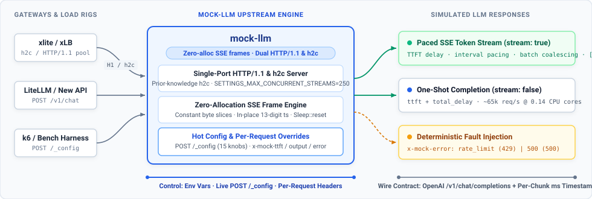

# mock-llm

**mock-llm** is a high-concurrency, zero-allocation OpenAI-compatible mock upstream server written in Rust. Designed for stress-testing AI gateways ([xlite](https://github.com/EeroEternal/xlite), [LiteLLM](https://github.com/BerriAI/litellm), [New API](https://github.com/QuantumNous/new-api), [AISIX](https://github.com/api7/aisix)) and streaming load balancers ([xLB](https://github.com/EeroEternal/xlb)), it serves both **HTTP/1.1** and **cleartext HTTP/2 (`h2c`)** on a single port while keeping per-chunk CPU cost near zero.

<p align="center">
  
</p>

## Why mock-llm

When benchmarking an AI gateway at 10,000–20,000 concurrent SSE streams (millions of chunks per second), naive mock servers become the CPU bottleneck before the gateway under test does.

- **Zero-Allocation SSE Frame Assembly** — Pre-renders `chat.completion.chunk` frames from constant byte slices and patches only the 13-digit millisecond timestamp (`ts`) in place into a reusable `BytesMut` buffer, paired with `tokio::time::Sleep::reset` timer reuse.
- **Dual-Stack HTTP/1.1 & `h2c` on One Port** — Automatically serves HTTP/1.1 keep-alive and HTTP/2 prior-knowledge (`h2c`) connections on the same listener, advertising `SETTINGS_MAX_CONCURRENT_STREAMS = 250` for realistic HTTP/2 pool benchmarking.
- **Live Runtime Reconfiguration (`POST /_config`)** — Switch between workload profiles (TTFT delay, token interval, output token count, write batching, or randomized short/mid/long token mixes) between benchmark stages without restarting processes.
- **Per-Request Latency & Fault Injection Headers** — Override `ttft`, `output`, `duration`, or inject deterministic HTTP `429 Too Many Requests` / `500 Internal Server Error` responses via `x-mock-*` request headers to test gateway failover and circuit breaking.

## Quick Start

```bash
cargo build --release
PORT=8081 MOCK_TTFT=500 MOCK_OUT_TOKENS=100 ./target/release/mock-llm
```

Stream an OpenAI-compatible SSE response:

```bash
curl -N http://127.0.0.1:8081/v1/chat/completions \
  -H "Content-Type: application/json" \
  -d '{"model":"mock","stream":true,"messages":[{"role":"user","content":"hi"}]}'
```

Update workload parameters at runtime (or read current config with `POST /_config` and no query string):

```bash
curl -X POST "http://127.0.0.1:8081/_config?ttft=500&out_tokens=250&token_interval=20&batch=1"
```

Inject per-request overrides or upstream errors (`429` / `500`) to verify gateway failover:

```bash
curl -i http://127.0.0.1:8081/v1/chat/completions \
  -H "x-mock-error: rate_limit" \
  -d '{"model":"mock","stream":true}'
```

## Configuration & HTTP Contract

### Environment Variables & `/_config` Query Keys

| Env Variable | `/_config` Key | Default | Description |
| :--- | :--- | :--- | :--- |
| `PORT` | *(env only)* | `8081` | TCP listen port on `0.0.0.0` |
| `MOCK_TTFT` | `ttft` | `500` | Pre-first-token delay in ms |
| `MOCK_OUT_TOKENS` | `out_tokens` | `50` | Number of content SSE frames emitted per stream |
| `MOCK_TOKEN_INTERVAL` | `token_interval` | `0` | Inter-frame interval in ms (`0` falls back to `MOCK_STREAM_DEFAULT_INTERVAL`) |
| `MOCK_STREAM_DEFAULT_INTERVAL` | *(env only)* | `20` | Fallback interval in ms when `token_interval = 0` |
| `MOCK_BATCH` | `batch` | `1` | Coalesce every `N` content frames into a single socket write (byte-identical payload) |
| `MOCK_TOTAL_DELAY` | `total_delay` | `0` | Additional delay in ms for non-streaming responses (`ttft + total_delay`) |
| `MOCK_RESPONSE_SIZE` | `response_size` | `0` | Total content byte budget (`0` = 4 bytes per frame) |
| `MOCK_MAX_DURATION` | `max_duration` | `0` | Max streaming duration in ms before frame truncation (`0` = unlimited) |
| `MOCK_MIX` | `mix` | `0` | When `1`, sample `out_tokens` across `long` / `mid` / `short` tiers by percentage |
| `MOCK_LONG_PCT` / `MID_PCT` / `SHORT_PCT` | `long_pct` / `mid_pct` / `short_pct` | `20` / `30` / `50` | Percentage weights when `mix = 1` |
| `MOCK_LONG_OUT` / `MID_OUT` / `SHORT_OUT` | `long_out` / `mid_out` / `short_out` | `500` / `250` / `100` | Output token counts for each tier when `mix = 1` |

### Per-Request Override Headers

| Header | Example | Effect |
| :--- | :--- | :--- |
| `x-mock-ttft` | `x-mock-ttft: 100` | Override `ttft` (ms) for this request |
| `x-mock-delay` | `x-mock-delay: 50` | Override `total_delay` (ms) for this request |
| `x-mock-output` | `x-mock-output: 500` | Override `out_tokens` for this request |
| `x-mock-size` | `x-mock-size: 4096` | Override `response_size` (bytes) for this request |
| `x-mock-duration` | `x-mock-duration: 2000` | Override `max_duration` (ms) for this request |
| `x-mock-error` | `rate_limit` or `500` | Return HTTP `429 Too Many Requests` or `500 Internal Server Error` immediately |

## Verification

```bash
cargo test
```

## License

Released under the [MIT License](LICENSE).
